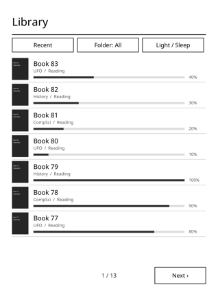
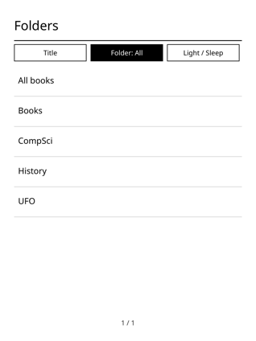
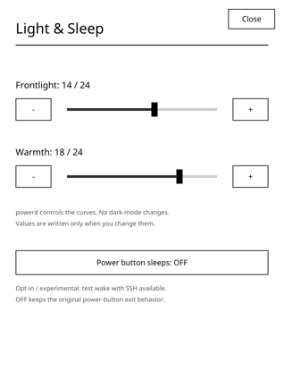
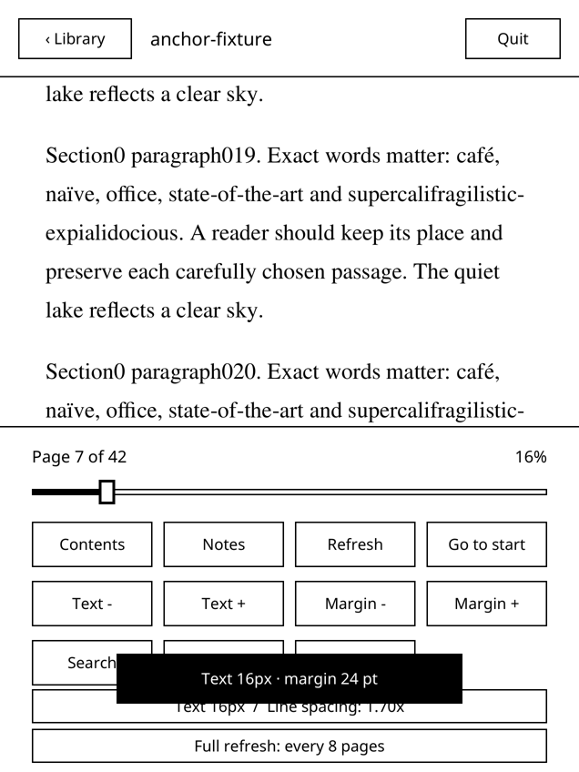
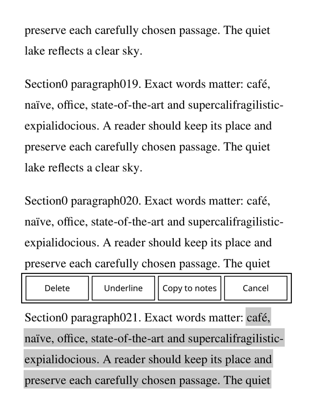
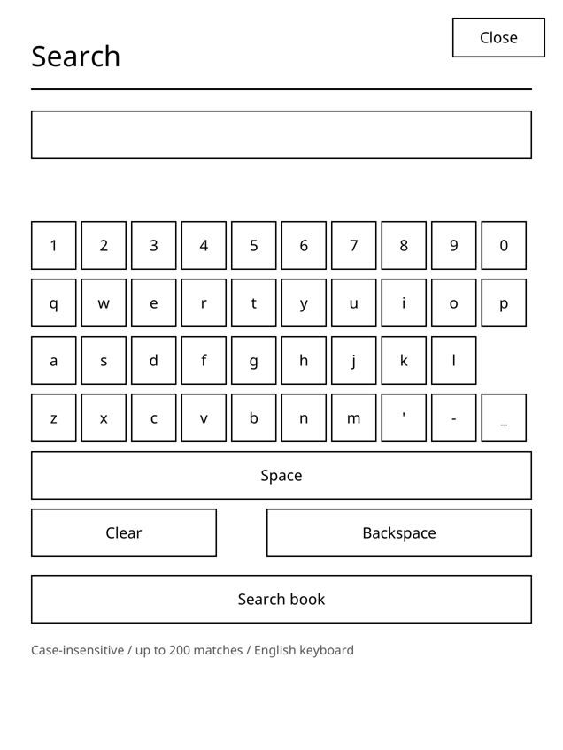
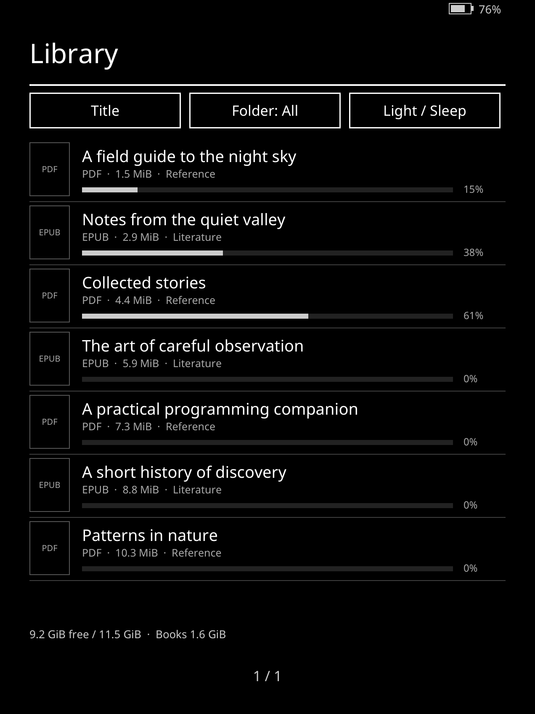
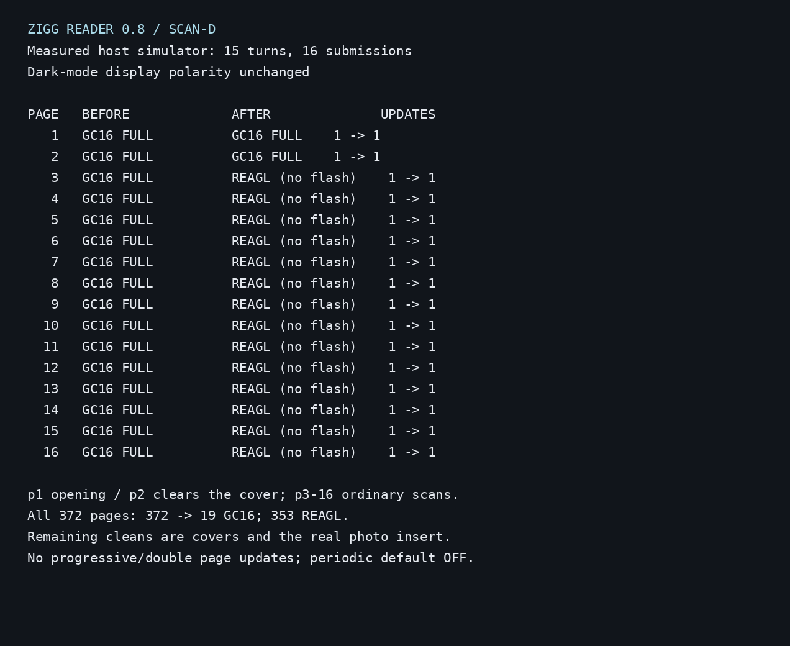
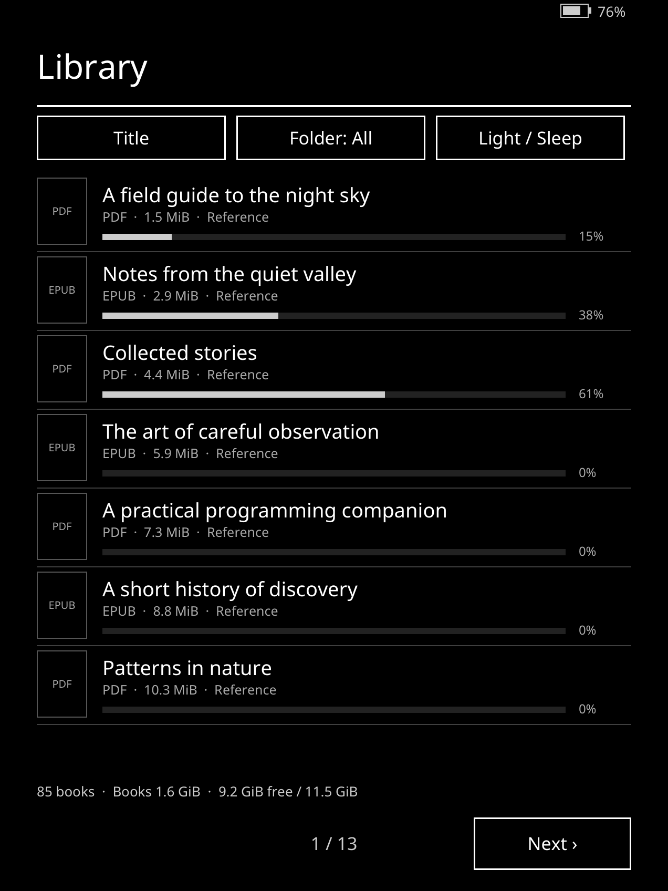
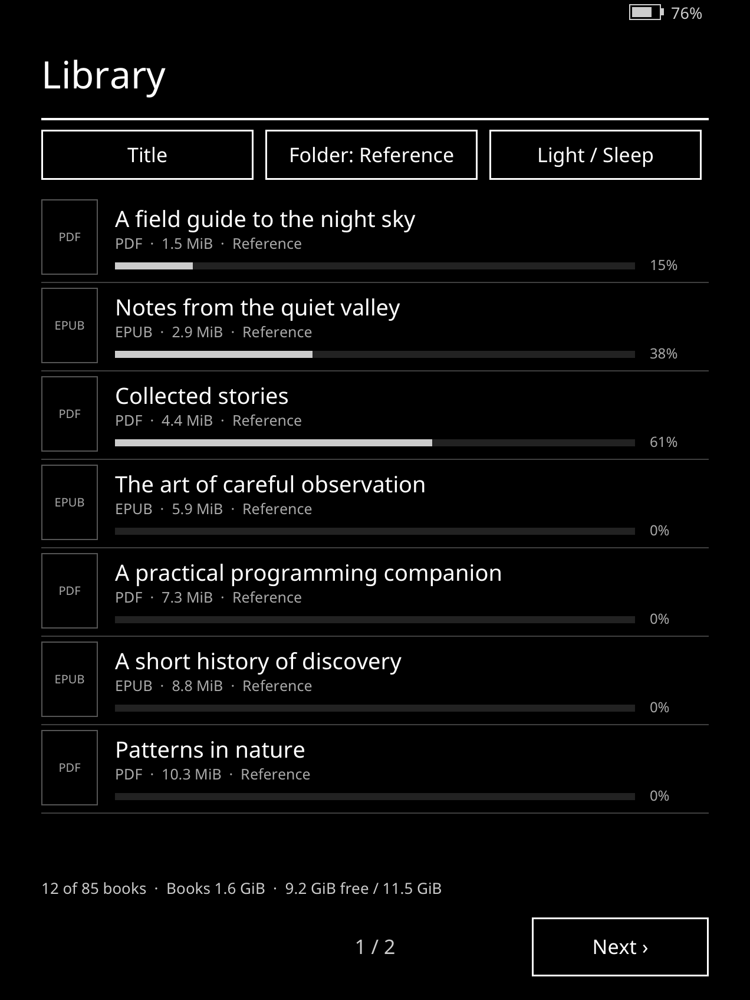

# Zigg Reader

A small, standalone reader for PDF, EPUB, MOBI, AZW3, TXT, CBZ and FB2, written in Zig and C for a jailbroken **Kindle Paperwhite 12th generation (PW6)**. The executable is `zreader`; KUAL calls it “Zig reader”. These names refer to the same application.

**Version: 0.10.3 · tested device family: PW6 only · other Kindles: untested.**

This project is not replacement firmware. It temporarily pauses the stock interface while reading and restores it on exit. It does not remove Amazon's operating system, alter system partitions, or replace the jailbreak.

> Read the safety and recovery instructions before installing. Power-button sleep is experimental and off by default; leave it off for normal use.

## Why this exists

KOReader is a feature-rich reader, and it made SSH access to the Kindle easy. On this Kindle, though, it felt laggy: page turns and taps didn't respond as quickly as we wanted. Zigg Reader was built as a small native Zig reader focused on speed: fast page turns, clean e-ink refreshes and no bloat, while keeping the features that matter for reading PDFs and EPUBs.

## Start here

1. [Prerequisites and access](docs/PREREQUISITES.md)
2. [Install or upgrade](docs/INSTALL.md)
3. [Controls and features](docs/USER_GUIDE.md)
4. [Safe cleanup and what changed](docs/DEBLOAT.md)
5. [Recovery and troubleshooting](docs/TROUBLESHOOTING.md)
6. [Uninstall and rollback](docs/UNINSTALL.md)

Developers: [build](docs/BUILD.md) · [tests and evidence](docs/TESTING.md) · [architecture](docs/ARCHITECTURE.md) · [known limitations](docs/LIMITATIONS.md) · [benchmark](docs/BENCHMARK.md) · [roadmap](docs/ROADMAP.md) · [licences](THIRD_PARTY.md).

## Version history

Full details in [CHANGELOG.md](CHANGELOG.md). Earlier versions were early prototypes and are not listed.

| Version | Scope |
| --- | --- |
| 0.4 baseline | PDF/EPUB reading, recursive library, reading-position persistence, directional pre-rendering, two render workers and 14 raster-cache slots; queued page-turn taps are merged rather than rendering every intermediate target. |
| 0.5 | Precise word hit testing in the displayed page coordinates; word-snapping drag selection and adjustable endpoints; underlines/highlights; tap a mark to delete, change style or copy its passage; JSON and text notes rewritten after edits. |
| 0.5.1 | REAGL for normal text; GC16 FULL for heavy image/dark transitions and context changes; full refresh Off/4/8/16 (default 8); conservative image-only grayscale dithering. Inherited hardware dark mode is preserved, not emulated or switched off. |
| 0.6 | PDF fit-page/fit-width/1.5×/2× and pan; EPUB persistent text anchors, adjustable typography and spacing; offline WordNet English dictionary; incremental in-book search; JSON/TXT/Markdown exports; reversible crash-dump marker helper. |
| 0.7 | Lazy library covers, relative folders, Recent/Title/Progress sorting and progress bars; frontlight and warmth via LIPC only; experimental opt-in power-button sleep and independent emergency recovery. |
| 0.11.2 | Instant zoom and pan. Zooming in or panning on a PDF now shows an immediate scaled copy of the current screen (a few milliseconds) while the sharp page renders, then replaces it in place; the final page is identical to 0.11.1. Renders slower than 150 ms are logged as `slow render` lines with page, step, view and time, to help find slow books. Digital PDFs and EPUBs render exactly as before. |
| 0.11.1 | Two-page scans, one page at a time. Scanned PDFs where each page is a landscape scan of two book pages (an image covering almost the whole page) are now shown one book page at a time, full screen in portrait: the next tap shows the right-hand page, the next one the following scan's left-hand page, and back taps go the other way. The gutter is found automatically (the widest band without text near the middle of the scan; the exact centre if there is none), and the facing page never shows at the edge. The other half and the following pages are pre-rendered as before, so turns stay fast with no extra flashes. Your position remembers the half, so a book reopens on the same page; older saved positions open on the left half. The page number shown stays the real PDF page, with L or R in the menu (for example “Page 58 L of 188”). A per-book **Split: on/off** button in the in-book menu (on by default) turns it off for a book. Portrait pages, digital PDFs and EPUBs are not affected. |
| 0.11.0 | Shrink for Kindle (opt-in, runs on the Kindle). Long-press a PDF in the library and choose **Shrink for Kindle** to make a smaller copy for this screen: every colour or greyscale image is converted to greyscale, downsampled to about 1.25× the resolution the 1272×1696 screen can show at the image's placed size (never upscaled; images that are already small are left alone) and re-encoded as JPEG; 1-bit images (JBIG2/CCITT) are kept as they are. The text layer, fonts, links, page count and page sizes are unchanged, so search, highlights, notes, the dictionary and saved positions keep working. The run happens in the background with a cancellable “Shrinking page N/M” line, checks for enough free space first, and works in a temporary file next to the book that is removed on cancel. It then shows the size before and after: **Use smaller copy** replaces the book in place and moves the original to `originals/` in the reader's data folder (`/mnt/us/zreader/originals/`, same sub-folders), **Discard** keeps the book as it was. If the copy is not at least 10% smaller the original is kept. The originals stay until you choose **Delete originals** (with a confirmation) from the library menu, which shows how much space they use. On five large scanned and illustrated PDFs the total went from 742 MB to 291 MB (61% smaller; 10–38 s each on a desktop, under 180 MB of memory); PDFs that are already compact (for example Internet Archive scans) gain little and are kept. A small MuPDF patch (`mupdf-patches/08`) adds the greyscale conversion and the progress/cancel hooks to MuPDF's image rewriter; it is only active while shrinking, so rendering is unchanged. `zreader --shrink IN.pdf OUT.pdf` does the same from the command line. |
| 0.10.6 | Readable highlights on scanned pages and accented letters on the keyboard. On scanned (image) PDF pages a highlight could turn into a dark box over the print, because each overlapping text box darkened the page again; on these pages a highlight now lightens the paper to a light grey and leaves the print as it is, so overlaps never build up. Highlights on other PDFs and on EPUB and other reflowed books are unchanged, and there is no extra flash. The search and note keyboards have a new **ÀÉ** key that switches the letter rows to á à â ä ã å æ ç é è ê ë í ì î ï ñ ó ò ô ö õ ø œ ú ù û ü ý ÿ ß (plus ¿ ¡ « » €); **abc** switches back. In the note keyboard Shift gives the capitals (Á … Ÿ). Backspace in search now removes a whole accented letter. Search remains case-insensitive. |
| 0.10.5 | Faster turns through heavy scanned pages: when the page you turn to is a heavy colour picture page, it is shown at once as a draft and the exact page replaces it with a non-flashing update, as for the first page in 0.10.4. The page you are waiting for now always comes before pre-rendering: if both background workers are busy with other pages, one of them is stopped and restarted later. Final pages are byte-identical and there are no extra flashes. Kindle, scan-C, cold open: average of the first 8 pages 2.29 s → 0.53 s (slowest 8.2 s → 0.78 s), turn p90 496 → 134 ms, slowest turn 3.67 → 2.76 s; warm turns unchanged (about 11 ms). |
| 0.10.4 | Fast first page on scanned PDFs: opening a scanned book whose first page is a colour picture page (typically an Internet Archive cover) took 5.9 s (scan-B) and 13.0 s (scan-C) on the Kindle before anything appeared; it now appears in 0.67 s and 0.65 s. Cause: such a page holds full-resolution JPEG 2000 colour layers that were decoded at full size twice (once for the margin trim, once for the screen), every JPEG 2000 decode in the reader waited on one global lock, and the background page workers queued behind it. Now the first page is shown at once as a draft (half resolution, large images decoded at reduced resolution), and the exact page replaces it with a non-flashing update about 4–6 s later; the final page is byte-identical to 0.10.3 and there is no extra flash. Two small MuPDF patches (`mupdf-patches/06`, `07`) let JPEG 2000 images decode in parallel on both cores and reuse one full-size decode for both scales; output is unchanged. Reopening an EPUB at a saved place without a cached layout now lays out only the chapters up to that place and counts the rest in the background (book-E, 613 pages: 3.2 s → 1.5 s to open at the middle). On-device benchmark in `tools/bench/` (runs headless over SSH, keeps powerd awake and the governor as the reader sets it, restores both); reports in `benchmarks/2026-11-07/`. MuPDF built with -O2 was pixel-identical but not faster on the device, so the release build stays at -Os. |
| 0.10.3 | Latin dictionary: Look up now also searches an offline Latin dictionary built from William Whitaker’s WORDS data (`dictionary/latin.zdict`, 5,042,113 bytes). Inflected forms find their headword and the form is named: *amavit* → amo, amare, amavi, amatus (perf. act. ind. 3rd sg.); *rosarum* → rosa, rosae (gen. pl.); *est* → sum; *virumque* → vir + -que. Macrons and accents are ignored, and u/v and i/j count as the same letter. In a book whose declared language is Latin (EPUB `dc:language`, FB2 `lang`, PDF `/Lang`) Latin is looked up first; elsewhere English comes first and Latin is used when English has no entry. **EN** and **LA** buttons in the lookup popup switch between the two. A lookup takes about 10 µs on a desktop (well under 1 ms on the Kindle). Without `latin.zdict` the popup is exactly as before. The data's attribution and licence are in `dictionary/LATIN-LICENSE`; `dictionary/build_latin.py` rebuilds the file byte-identically from `dictionary/source/whitaker-words-data.tar.gz`. |
| 0.10.2 | More formats: DRM-free **MOBI**, **AZW3** (KF8), **TXT**, **CBZ** comics and **FB2** now open alongside PDF and EPUB, with the library (type and size shown), Wi-Fi upload, sorting, collections, stats, bookmarks and Contents. MOBI, AZW3, FB2 and TXT are reflowed like EPUB, with text size, margins, line spacing, Font, Align and hyphenation, plus highlights, notes, search and the dictionary; CBZ pages are images fitted to the screen. TXT files become paragraphs, and lines such as “CHAPTER I.” become headings that start a new page and fill Contents. AZW3 files are joined from their KF8 parts with their own CSS (internal links are not followed yet). MOBI, AZW3 and FB2 chapters start on a new page, and their Contents is detected when the file has no useful outline. DRM-protected MOBI/AZW/AZW3, Amazon KFX and encrypted EPUBs show “This book is DRM-protected and can't be opened” instead of a blank page; damaged files show “Could not open this book”. Small MuPDF patches in `mupdf-patches/` (02–05) do the TXT paragraphs, the azw/azw3 names, page breaks for non-EPUB books and the KF8 join; they are off for PDF and EPUB, whose pages are byte-identical to 0.10.1. CBR (RAR) and KFX are not supported. (Released on the device together with 0.10.3.) |
| 0.10.1 | Contents for books without an outline: when a PDF or EPUB has no table of contents, opening Contents scans the text (the OCR text layer for scanned books) in the background for chapter headings near the top of a page (CHAPTER/Chapter/PART/BOOK with digits, roman numerals or number words, plus Preface, Prologue, Epilogue, Notes, Index and similar). Progress is shown and you can keep reading; the result is cached in `state/contents/` and labelled “Contents (detected)”. Running headers and stray matches are rejected; if nothing reliable is found, no entries are shown. Contents of such books always offers “Go to page...” and “Go to %...” with number entry. Books with a real outline are unchanged, and page turns are not slowed while the scan runs. A 772-page scanned book takes about 0.55 s on a desktop and a few seconds on the Kindle. Printed contents pages are not parsed yet, and a heading the OCR misread is skipped. |
| 0.10.0 | Better EPUB text (EPUBs only; PDF pages unchanged): two new EPUB menu buttons either side of line spacing. Align cycles “Justify + hyphens” (the new default), “Justify” and “Align: original” (exactly the 0.9.x layout); Font cycles “Font: book” (the book’s own fonts), “Font: Charis” (Charis SIL serif) and “Font: Noto Sans”. Both are saved in `ui07.json`, and changing them re-lays the book out at the same place. Hyphenation uses MuPDF’s built-in patterns (English, German, French, Spanish, Italian, Portuguese, Russian and others) plus compact Latin patterns; books that declare no language are hyphenated as English, and `xml:lang` is honoured (a small MuPDF patch in `mupdf-patches/`, applied by `build-mupdf.sh`). A book’s own centred or right-aligned paragraphs keep their alignment. Adds about 0.39 MB (Noto Sans Bold/Italic/Bold Italic, Latin subsets). |
| 0.9.9 | Battery saving and a low-battery warning: the reader no longer wakes on a timer while you read or sit in the library. The input loop sleeps until a touch, the power button, a finished page or cover, or its next real deadline; the device helper thread, which used to wake every 20 ms (about 50 times a second), now waits for a request, a powerd event or its 3-minute battery read. Host measurements: idle wakeups about 10/s → 0/s in the reader and library, and about 50/s → 0.1/s in the device thread. Page turns, pixels, the refresh policy and the exit gesture are unchanged; the frontlight and Wi-Fi radio are not touched. In the library only, a notice under the battery reads “Battery low (N%) · charge soon” at 15% or less and “Battery very low” (white on black) at 5% or less; it is drawn with the normal library update and never over book pages. |
| 0.9.8 | Collections, favourites and size sort: long-press a book in the library for Favourite, Add to collection, Remove from collection or Cancel; favourites get a small star. The Folder button now opens “Show”: All books, the folders, Favourites, each collection and “+ New collection” (the current sort is kept). Long-press a collection there to rename or delete it; deleting never removes books. Names use the on-screen keyboard. The Sort button adds “Size: largest first” and “Size: smallest first”, using the file sizes the library already reads; the chosen sort is kept across restarts. Collections are stored in `state/collections.tsv`; a book renamed with an upload “(N)” suffix stays in its lists. Includes 0.9.7 reading stats. |
| 0.9.7 | Reading stats, kept on the Kindle only: Settings › Reading stats shows today, last 7 days and all-time reading time, books finished, a day streak, a 7-day bar chart and the most recent books; Reset stats asks for a second tap. Contents shows the open book’s time read, pages, sessions and percent, plus an estimate of the time left for EPUBs. Only active reading counts (a page on screen, menu closed, awake, a page turn within 2.5 minutes). Stats are saved in `state/stats.tsv` at most once a minute and on close, sleep and exit, never during page turns. Book pages are unchanged. (Released on the device together with 0.9.8.) |
| 0.9.6 | Highlights and notes, with export: long-press a word, then drag or tap the end word (EPUB text and PDFs with a text layer, including OCR scans). The popup offers Highlight, Underline, Note, Look up (single word, offline dictionary), Copy to notes and Cancel. Note saves a highlight and opens a compact on-screen keyboard. Tapping a highlight offers Edit note, Remove, change style, Copy to notes and Cancel. The menu’s Notes button opens “Highlights & notes” (page, style, date, passage, note; tap to jump, long-press to delete). Highlights are drawn with the normal page update and never stored in the page cache; pages without them are unchanged. Export: the Upload screen’s web page offers each book’s highlights and notes, plus an all-books file, as Markdown or plain text while the screen is open, and the same files are kept in `export/` on the Kindle for USB. Nothing is sent anywhere automatically. |
| 0.9.5 | Bookmarks: “Bookmark” / “Unbookmark” in the PDF menu’s second row and a “Bookmarks” button for PDF and EPUB. The Bookmarks screen lists them in page order with the date and the first words of the page; tap to jump, long-press to delete, and its bottom button bookmarks or un-bookmarks the current page. A bookmarked page shows a small ribbon at the top right, drawn with the normal page update (no extra flash). Bookmarks are stored per book on the Kindle and EPUB bookmarks follow reflow. Pages without a bookmark look exactly as before. `--version` now prints the correct version. |
| 0.9.4 | Tidier in-book menu: “Up” and “Down” are removed (tapping or swiping the page does the same), leaving room for future buttons. Faster launch: SSH setup, the screen snapshot and the UI-pause settle delay now overlap instead of running one after another (an estimated 0.3–1 s saved), and the log gets a “launch profile:” timing line. Faster scans: a single full-page JPEG 2000 scan page is decoded at screen resolution when Clean up scanned pages is on (covers, photos and digital pages unchanged). A “slow pages:” log line flags books whose pages render slowly. Known issue: the 0.9.4 binary reports its version as 0.9.3; fixed in 0.9.5. |
| 0.9.3 | Fast, clean Internet Archive scans: many scanned PDFs store each page as a small JPEG 2000 background, a full-size JPEG 2000 foreground and a 1-bit text mask. These pages took several seconds per turn and looked gray and blotchy. With Clean up scanned pages on, such pages are now drawn as white paper with crisp black print, skipping the slow full-size JPEG 2000 decoding (about 5–10× faster on a desktop). Pages whose background holds a picture are drawn normally, and digital books are unchanged. The reader-menu “Cleanup: every N pages” button is renamed “Full refresh” and is reset to off once, so there are no periodic full flashes by default. |
| 0.9.2 | Clean up scanned pages: scanned books on yellowed or sepia paper no longer show blotchy stain-like bands on a gray page; the paper becomes white and the print dark. Only pages that are a full-page scan image are changed. EPUBs, text PDFs and digital PDFs with photos or figures look exactly as before (byte-identical in tests). New setting Library → Settings → Clean up scanned pages (ON by default); `--no-clean-scans` turns it off from the command line. No extra screen flash; about 5–7 ms more render time per scanned page on a desktop. |
| 0.9.1 | Wi-Fi book uploads: Library → Settings (formerly Light / Sleep) → Upload books over Wi-Fi shows an address to open in a phone or computer browser on the same Wi-Fi. PDF and EPUB only, up to 500 MB each; checked file names; existing books are never overwritten (a copy becomes “Name (2).epub”); files are written to a temp file and renamed into the Books folder; an upload is refused if it would leave less than 6 GB free. The upload page runs only while that screen is open, on one port, and the library refreshes afterwards. |
| 0.9.0 | Instant reopen: the page you stopped on is saved as a small image (page pixels only, about 80–125 KiB per book, 20 MiB total with oldest removed first) and shown at once when you reopen the book; the real page is drawn behind it and only updated if it looks different, with no extra flash. Page turns tapped while a book is still opening are queued and applied as soon as it is ready. The battery icon and percentage now appear only in the library, never over the text of an open book. New `clear-cache` maintenance command removes the saved pages. |
| 0.8.2 | Fast tapping the library Next/Prev buttons (or fast corner page turns) no longer exits the reader. The exit shortcut is now a triple-tap in the top-left corner on the library and other list screens only; any other tap resets it. While reading, quit via the menu (tap centre) → Quit. |
| 0.8.1 | Library page changes no longer flicker while covers load: a cached page is one non-flashing update; uncached covers fill in with at most two partial updates limited to the cover column; no full flash on library page changes. Covers already loaded stay ready across page changes. Book count on the library bottom line (“85 books”, or “12 of 85 books” inside a folder). |
| 0.8.0 | Scanned-book flicker fix: grey paper tone is no longer counted as a heavy image (scan-D-type 372-page scan: 372/372 GC16 flashes → 353 REAGL + 19 intentional cleans for opening, cover and real photo pages). Periodic full refresh Off by default and its bottom label removed. Persistent cover cache (≤10 MiB) with instant placeholders and next-page prefetch. Faster first page and EPUB pagination cache. Library storage line (free/total, books total) and per-book type and size. Battery bar and percentage top-right (read-only, no extra refresh). 64-bit timestamp fix for “opened”. App core dumps disabled. Known limitation: first cold open of a big EPUB with a deep saved spot can still be slow once. |

Notes are overlays: original book files are never modified. Books belong in `/mnt/us/Books`, including subfolders. DRM-protected books are not supported: they show “This book is DRM-protected and can't be opened”.

## Performance (0.10.4, on the Kindle)

Kindle Paperwhite 12th gen, measured with the headless bench in [tools/bench](tools/bench/) (CPU governor as the reader sets it, cold open with empty caches). Reports: [benchmarks/2026-11-07](benchmarks/2026-11-07/).

| Book | 0.10.3 first page | 0.10.4 first page (draft) | 0.10.4 exact page |
| --- | --- | --- | --- |
| scan-B (scanned PDF, 772 pages) | 5.9 s | **0.67 s** | about 4.2 s |
| scan-C (scanned PDF, 478 pages) | 13.0 s | **0.65 s** | about 5.9 s |

Normal pages of these scans render in about 0.34–0.37 s each in the background and are pre-rendered, so steady page turns stay at about 6 ms to the framebuffer. Reopening an EPUB at a saved place without a cached layout (book-E, 613 pages) takes 1.5 s instead of 3.2 s. 0.10.5 removes most of the remaining stall on heavy front-matter pages right after opening (scan-C, cold open, 0.10.4 → 0.10.5):

| Measure | 0.10.4 | 0.10.5 |
| --- | --- | --- |
| First 8 pages, average | 2,294 ms | **533 ms** |
| First 8 pages, slowest | 8,179 ms | **779 ms** |
| Page turn p90 | 496 ms | **134 ms** |
| Slowest page turn | 3.67 s | **2.76 s** |
| Slowest background render | 8.2 s | **6.2 s** |

Warm page turns are unchanged (p50 about 11 ms).

## Benchmark: Zigg Reader vs KOReader

In this test on one device (Kindle Paperwhite 12th gen, Zigg Reader 0.8.0 vs KOReader as installed), with identical injected touch events, a 1.5 MB EPUB and a 47 MB scanned-image PDF. Times run from touch injection to the framebuffer changing, not to the e-ink panel finishing. Lower is better. Full method and raw data: [docs/BENCHMARK.md](docs/BENCHMARK.md).

| Metric (median) | KOReader | Zigg Reader |
| --- | --- | --- |
| Page turn, EPUB (20 turns) | 59 ms | **45 ms** |
| Page turn, scanned PDF (20 turns) | 1,286 ms (6 of 20 at ~43 ms, the rest 0.3–2.7 s) | **58 ms** (max 83 ms) |
| Book open to ready, EPUB (3 opens) | 3.1 s | **1.8 s** |
| Book open to ready, scanned PDF (3 opens) | 5.1 s | **2.6 s** |
| 10 rapid taps, EPUB: page changes seen | 8 of 10 | **10 of 10** |
| Memory (RSS), EPUB | **52 MB** | 57 MB |
| Memory (RSS), scanned PDF | **133 MB** (peak 156) | 316 MB (peak 336) |

Zigg Reader uses more memory on the PDF because it pre-renders and caches nearby pages, which is what keeps its page turns fast. Rapid taps on the PDF were inconclusive, and KOReader's library-launch samples were invalid, so neither is compared here.

About these numbers: times are to the framebuffer update; the e-ink refresh itself adds roughly 250 ms for both readers. The test measured steady forward reading, where Zigg Reader had already prefetched the next pages. On a heavy scanned PDF, a page that isn't prefetched yet (right after opening, after a jump, or when turning faster than pages render) can take about 1–3 s in Zigg Reader too. KOReader was measured the same way, so the comparison is like for like.

## Screenshots

These previews are rendered on a computer from sample books, so they don't show e-ink ghosting or the Kindle's hardware dark mode.

| Library | Folders | Light & Sleep |
| --- | --- | --- |
|  |  |  |

| EPUB typography | Selection and annotations | Search |
| --- | --- | --- |
|  |  |  |

| Storage and battery (0.8, mock data) | Scanned-book refresh log (0.8) |
| --- | --- |
|  |  |

| Book count (0.8.1, mock data) | Folder book count (0.8.1, mock data) |
| --- | --- |
|  |  |

## Space and distribution

The installed ARM executable is **7,409,304 bytes** (0.10.3), the WordNet index **14,449,559 bytes** (13.78 MiB) and the Latin dictionary **5,042,113 bytes** (4.81 MiB). The original compressed runtime is about 8.23 MiB. Allow at least 50 MiB free for a fresh installation, and more for upgrade backups and staging. Library thumbnails grow lazily to at most 10 MiB of cache payload, plus a small RAM cache. Books, notes and backups are additional.

On our test Kindle, cleanup recovered about 2.5 GB of crash dumps and 150 MB of VoiceView data, leaving about 9.2 GB free. Your numbers will differ. System partitions were left alone.

`release/zr103.tgz` is the current 0.10.3 runtime (about 10.1 MiB; installed about 25.7 MiB including both dictionaries); `release/zr101.tgz` (0.10.1) is kept for rollback. Checksums are in `release/SHA256SUMS`. `docs/REFERENCE_MANUAL.txt` is the detailed technical manual written during development.

## Safety

- Back up books, notes, reading state and an older runtime before changing anything.
- Keep a working **key-only SSH** recovery connection. Never enable passwordless/no-auth access.
- Never run the stock reader, KOReader and Zigg Reader together.
- Do not use USB mass storage while reading.
- Do not edit `/`, `/var/base-local`, kernel settings, startup jobs or system partitions for cleanup.
- Do not enable experimental sleep with a stock passcode or rely on it overnight.

Emergency command, on the Kindle over SSH:

```sh
sh /mnt/us/zreader/zreader-maintenance.sh restore-ui
```

## Licence

The MuPDF-linked application is distributed under **GNU AGPL version 3**; see [LICENSE](LICENSE). WordNet uses Princeton's separate licence; the Latin dictionary is built from William Whitaker's WORDS data (free for any use, attribution in `dictionary/LATIN-LICENSE`); embedded fonts retain SIL OFL notices. No books are included. The full reader source is in this repository, and the exact MuPDF source link and checksum are in [BUILD](docs/BUILD.md) and [THIRD_PARTY](THIRD_PARTY.md). If you share modified builds, please share your source too, as the AGPL asks.

## Credits

- [MuPDF](https://mupdf.com) by Artifex (AGPL) renders every format.
- WordNet 3.0, Princeton University, for the English dictionary.
- WORDS, a Latin dictionary, by Colonel William Whitaker (USAF, Retired), Copyright William A. Whitaker (1936-2010), for the Latin dictionary; data as published at github.com/mk270/whitakers-words.
- Noto Sans and Charis SIL fonts (SIL OFL); Latin hyphenation patterns by Claudio Beccari (hyph-utf8).
- Test text: the first chapters of *Alice's Adventures in Wonderland* by Lewis Carroll (public domain, Project Gutenberg eBook #11).
