# Zig Reader

**A fast, native e-reader for jailbroken Kindles, written in Zig with MuPDF.**

Version **0.12.3** · tested on a Kindle Paperwhite 12th generation (1272×1696) · other Kindles untested · GNU AGPL v3

| Library | Library (Dark) | Book menu |
| --- | --- | --- |
| 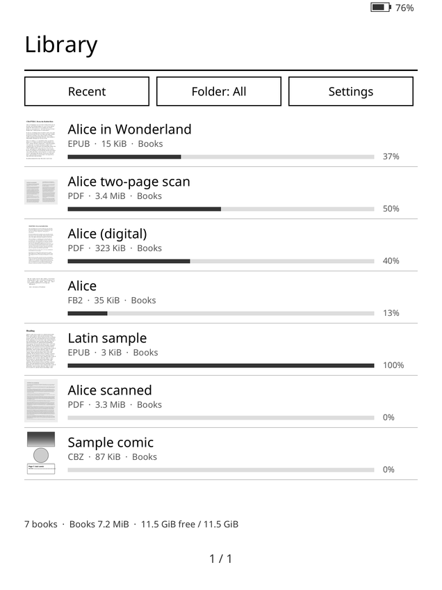 | 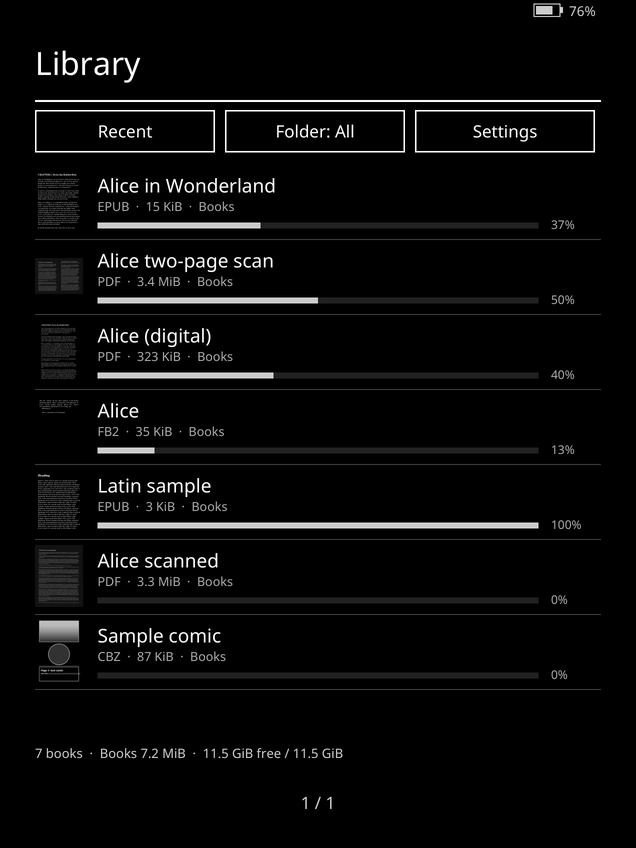 | 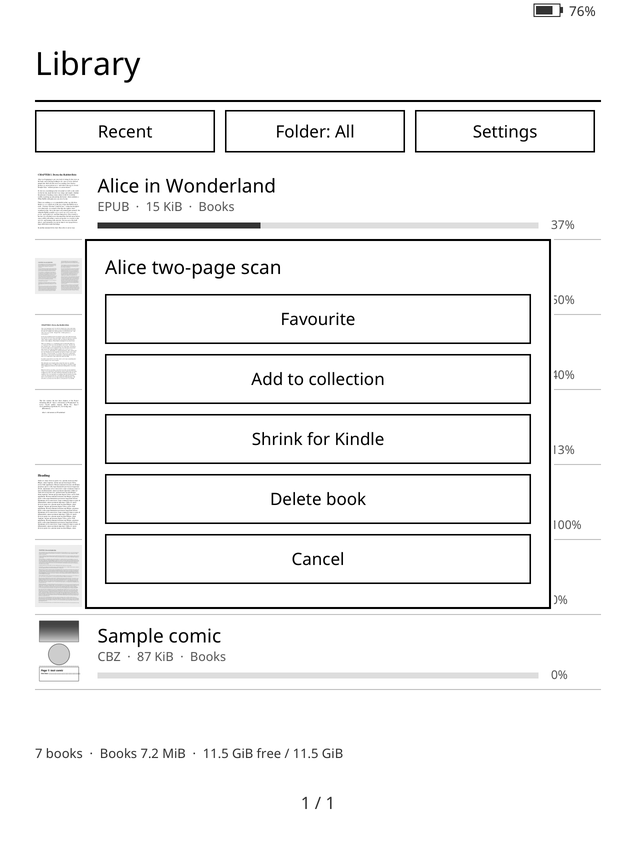 |

| Reader menu | View panel (EPUB) | More panel |
| --- | --- | --- |
| 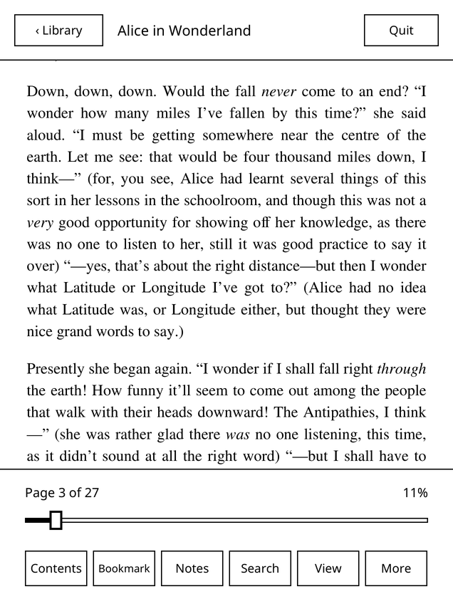 | 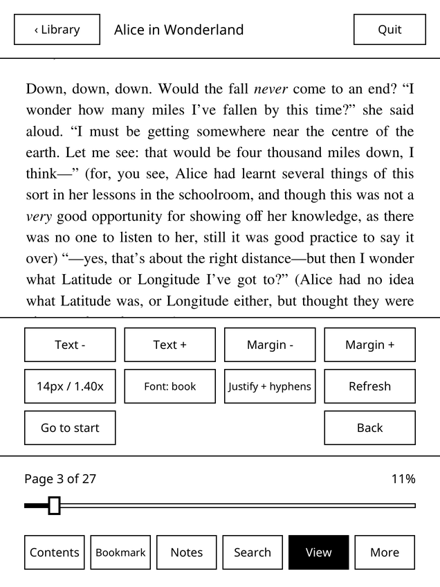 | 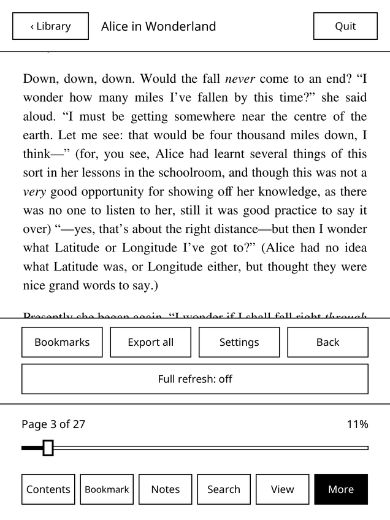 |

| View panel (scanned PDF) | Two-page scan, split | Reflow on a scanned page |
| --- | --- | --- |
| 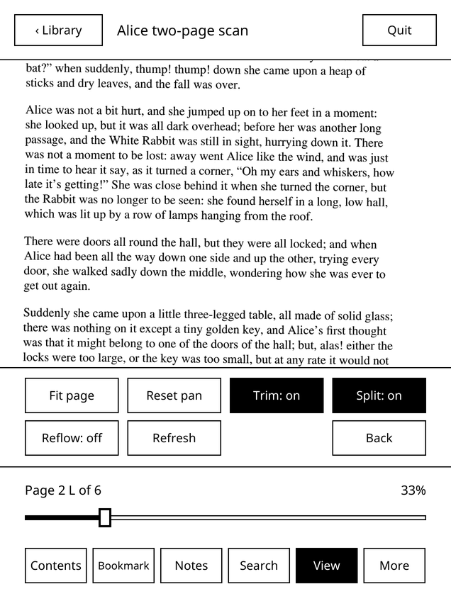 | 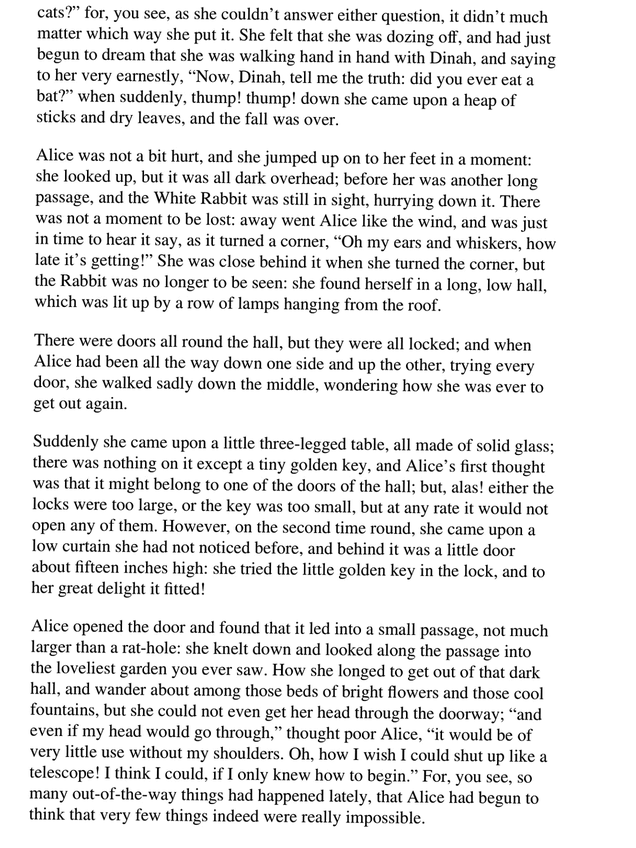 | 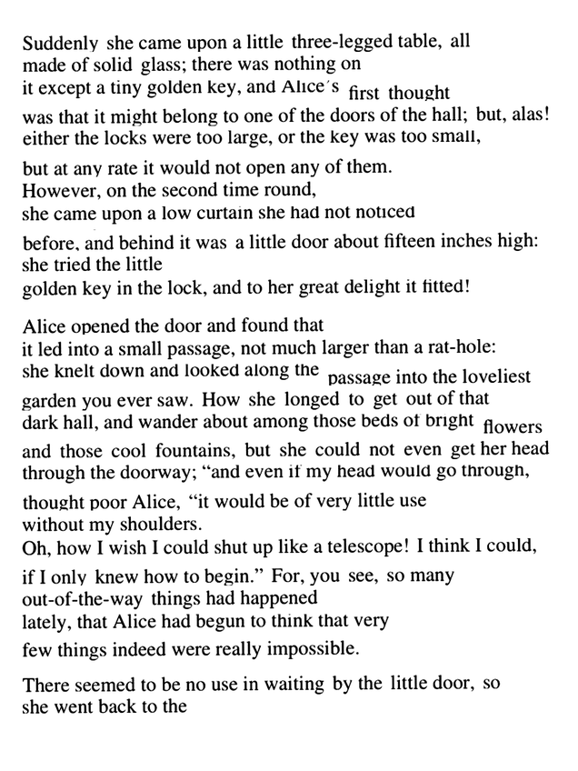 |

| Reading (Dark) | Shrink for Kindle |
| --- | --- |
| 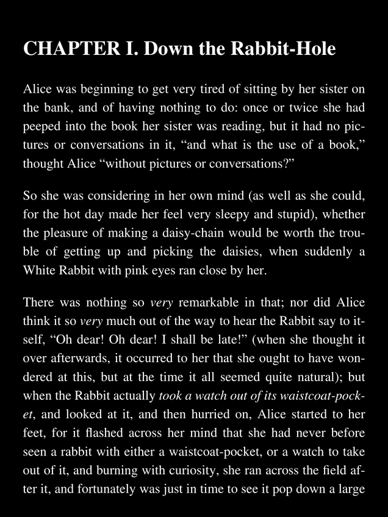 | 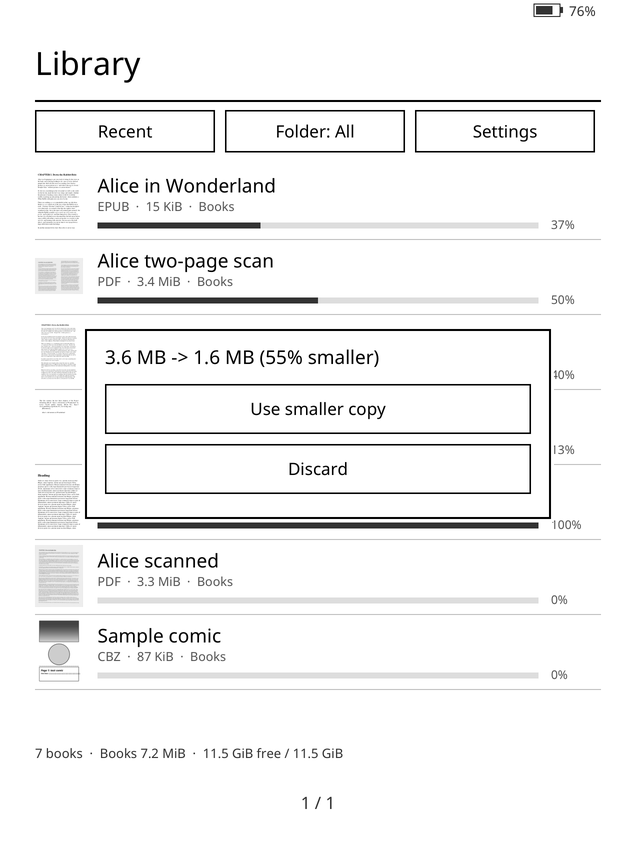 |

*I made these screens with the reader's own simulator (0.12.3), using the public-domain first chapters of Alice's Adventures in Wonderland (as EPUB, PDF and generated scans) and generated test files. They don't show e-ink ghosting.*

## Why

A weekend project. The stock Kindle software handles PDFs and scanned books poorly, and KOReader, while very capable, felt slow on this device for my use (page turns and taps lagging). Zig Reader is a small native program focused on fast page turns, good handling of large and scanned PDFs, and an e-ink-friendly interface. It is not firmware: it pauses the stock interface while it runs and restores it on exit.

## Features

**Formats** — PDF, EPUB, MOBI, AZW3 (KF8), TXT, CBZ and FB2 (DRM-free).

**Compact in-book menu** — tap the centre for one row: Contents, Bookmark, Notes, Search, View and More. **View** holds the display settings for the current book (text size, margins, spacing, font and alignment for reflowable books; fit and zoom, Trim, Split and Reflow for PDFs); **More** holds Bookmarks, Export all, Settings and the full-refresh setting.

**PDF and scanned books**
- **Reflow for scanned pages**: View → Reflow (1.5× or 2×) re-flows the words of a scanned page into larger text that fills the screen; tap through its screens, then on to the next page. Pages it can't reflow safely (mostly pictures, or spreads) stay in page view. Offered only for scanned PDFs, remembered per book.
- **Shrink for Kindle**: long-press a PDF to make a smaller greyscale copy sized for this screen; text, links, page count and notes keep working; the original is kept in `originals/` until you delete it. 0.12 also shrinks "mixed raster" scans and is faster on JPEG 2000 scans; a watchdog stops a run that makes no progress.
- **Two-page scans split** into single pages automatically (gutter detection, facing page never shows), per-book toggle (View → Split).
- **Scan cleanup**: whiter paper, darker text, gentle sharpening; **auto-trim** of margins on real scans (digital pages are untouched).
- Fit page, fit width, 1.5× and 2× zoom with pan; an instant scaled preview while the sharp page renders, and zoom stays on the current half of a split spread.
- Instant first page on heavy scans (draft first, exact page swapped in without a flash); nearby pages pre-rendered by background workers.

**Reading**
- Highlights, underlines and notes on PDF and reflowed books; bookmarks; Markdown/JSON/TXT export.
- Offline dictionaries: English (WordNet 3.0) and Latin (Whitaker's WORDS, with inflected forms).
- Contents (table of contents), in-book search, go to page, reading progress.
- Typography for reflowed books: size, margins, line spacing, Justify with hyphenation (English and Latin patterns), Charis SIL / Noto Sans / book font.
- **Theme: Light / Dark** in Settings (Dark uses the panel's inversion).

**Library**
- Covers, folders, collections and favourites; sort by recent, title, progress or size; progress bars; book count, storage and battery.
- **Delete book** from the long-press menu (confirmation, notes exported first, only inside the books folder).
- Upload books over Wi-Fi from a browser; frontlight and warmth controls.

**E-ink behaviour** — no periodic full refreshes; non-flashing updates for text, a clean refresh only where heavy images need it; fast or repeated taps never exit the app.

## Install

**Requirements:** a **jailbroken** Kindle with **KUAL** installed. Tested only on the **Kindle Paperwhite 12th gen**; other models are untested. SSH (key-only) is optional but useful for recovery.

Download `zr123.tgz` from the [v0.12.3 release](https://github.com/angel-andre/zig-kindle-reader/releases/tag/v0.12.3) (the same file is in [`release/zr123.tgz`](release/zr123.tgz)) and check it on your computer. Its SHA-256 must match the `release/zr123.tgz` line in [`release/SHA256SUMS`](release/SHA256SUMS):

```sh
sha256sum zr123.tgz      # macOS: shasum -a 256 zr123.tgz
# expected: 0ce698cc21297ec8f38b3e9adccdf8f976364a196147adb2ce3315a08271996b
mkdir zr123 && tar -xzf zr123.tgz -C zr123
```

(From a full clone you can instead run `sha256sum -c release/SHA256SUMS` in the repository root.)

Both routes put the files in the same places on the Kindle:

| In the archive | On the Kindle (USB drive) | On the Kindle (SSH path) |
|---|---|---|
| `out/zreader` (rename to `zreader`) | `zreader/zreader` | `/mnt/us/zreader/zreader` |
| `zreader-run.sh`, `zreader-maintenance.sh`, `README`, `COPYING` | `zreader/` | `/mnt/us/zreader/` |
| `dictionary/` (all files) | `zreader/dictionary/` | `/mnt/us/zreader/dictionary/` |
| `kual/zreader/` (the whole folder) | `extensions/zreader/` | `/mnt/us/extensions/zreader/` |

### A. USB drag-and-drop

1. Connect the Kindle by USB; it appears as a drive (its root is `/mnt/us` on the device).
2. Create a `zreader` folder at the drive root and copy into it: `out/zreader` (it must end up as `zreader/zreader`, not `zreader/out/zreader`), `zreader-run.sh`, `zreader-maintenance.sh`, `README`, `COPYING` and the `dictionary` folder.
3. Copy the `kual/zreader` folder into the existing `extensions` folder, so you get `extensions/zreader/menu.json`. Folders merge; don't replace `extensions`.
4. Put DRM-free books in a `Books` folder at the drive root (sub-folders are fine).
5. Eject the Kindle safely, unplug it, then open **KUAL → Zig Reader → Zig Reader (Library)**.

No `chmod` is needed. The Kindle's USB storage is FAT, so files can't carry permission bits, but the device mounts it with every file executable (this is how KOReader is installed too). The KUAL entry starts the launcher with `/bin/sh`, and the launcher runs `/mnt/us/zreader/zreader`.

### B. SSH

Copy `zr123.tgz` to `/mnt/us`, unpack it into an empty staging folder and copy the files to the paths in the table. The full step-by-step commands, including a backup first, are in [Install or upgrade](docs/INSTALL.md). Check with `/mnt/us/zreader/zreader --version` (expect `zreader 0.12.3`).

### Update

Quit the reader, then copy the new `zreader`, scripts, `dictionary/` and `extensions/zreader/` over the old ones by either route. Your notes and reading state live in other files and aren't overwritten.

### Where your data lives

Everything is in `/mnt/us/zreader/` (the `zreader` folder on the USB drive): `state/` (reading positions), `notes/` (highlights and notes), `export/` (exported notes), `settings.json`, `ui07.json`, `last_book`, `originals/` (originals kept by Shrink) and `cache/` (saved page images and reflow layouts, safe to delete). Logs are `/mnt/us/zreader.log` and `/mnt/us/zreader-stderr.log`. Books stay in `/mnt/us/Books`.

### Uninstall

Quit the reader, copy `zreader/state`, `zreader/notes` and `zreader/export` to your computer if you want to keep them, then delete the `zreader` folder and `extensions/zreader` (over USB or SSH). Your books, KUAL and the Kindle system are untouched. Details and rollback to the previous release (`release/zr115.tgz`): [uninstall and rollback](docs/UNINSTALL.md).

More: [user guide](docs/USER_GUIDE.md) · [prerequisites](docs/PREREQUISITES.md) · [release notes](release/README.md) · [troubleshooting](docs/TROUBLESHOOTING.md) · [safe cleanup](docs/DEBLOAT.md)

Developers: [build from source](docs/BUILD.md) · [tests](docs/TESTING.md) · [architecture](docs/ARCHITECTURE.md) · [benchmark details](docs/BENCHMARK.md) · [roadmap](docs/ROADMAP.md)

## Known limitations

- Tested on one device family (Paperwhite 12th gen); others are untested.
- Zoom and pan are limited by e-ink refresh; pan applies on release (no pinch).
- Some scans keep artefacts that are in the source file (for example stray marks in a separated text layer).
- Reflow is for single-column text; pages that are mostly pictures, or spreads, stay in page view, and some words can sit slightly off the line.
- Not supported: DRM-protected books, KFX, CBR. Links inside AZW3 books aren't followed yet.
- Dark depends on the e-ink panel honouring display inversion.

Full list: [docs/LIMITATIONS.md](docs/LIMITATIONS.md).

## Recent releases

| Version | Highlights |
| --- | --- |
| 0.12.3 | Faster Shrink on JPEG 2000 and already-small scans; better reflow next to pictures and captions. |
| 0.12.2 | Shrink watchdog; Shrink closes the open book first so it has the device to itself. |
| 0.12.1 | Shrink for "mixed raster" scans (picture layer plus text mask). |
| 0.12.0 | Compact menu with View and More panels; Reflow for scanned pages (1.5×, 2×). |
| 0.11.5 | Zoom/pan on the current half of split spreads; stale renders cancelled (latest wins). |
| 0.11.4 | Delete book from the library; Theme Light/Dark. |
| 0.11.3 | Shrink now really downsizes oversized scans; auto-trim on real scans; gentle sharpen in scan cleanup. |
| 0.11.2 | Instant zoom/pan preview; slow-render log. |
| 0.11.1 | Two-page scans shown one page at a time. |
| 0.11.0 | Shrink for Kindle. |
| 0.10.6 | Readable highlights on scanned pages; accented letters on the keyboard. |
| 0.10.5 | Heavy scanned pages shown as a draft first; the page you wait for comes before pre-rendering. |
| 0.10.4 | Fast first page on scanned PDFs. |
| 0.10.3 | Offline Latin dictionary in Look up. |
| 0.10.2 | MOBI, AZW3, TXT, CBZ and FB2 support. |
| 0.10.1 | Contents for books without an outline (detected chapter headings). |
| 0.10.0 | Better EPUB text: Align and Font options. |
| 0.9.9 | Battery saving and a low-battery warning. |
| 0.9.8 | Collections, favourites and size sort. |
| 0.9.7 | Reading stats, kept on the Kindle only. |
| 0.9.6 | Highlights and notes, with export. |
| 0.9.5 | Bookmarks. |
| 0.9.4 | Tidier in-book menu; faster launch and scans. |
| 0.9.3 | Fast, clean Internet Archive scans. |
| 0.9.2 | Clean up scanned pages setting. |
| 0.9.1 | Wi-Fi book uploads. |
| 0.9.0 | Instant reopen at the saved page. |
| 0.8.2 | Fast library taps no longer exit; new exit shortcut. |
| 0.8.1 | No flicker on library page changes while covers load; book count. |
| 0.8.0 | Scanned-book flicker fix; cover cache; faster first page. |
| 0.7 | Lazy library covers, sorting and progress bars; frontlight and warmth. |
| 0.6 | PDF fit/zoom and pan; EPUB typography; offline dictionary; search; exports. |
| 0.5.1 | Refresh modes tuned for text and images; full refresh setting. |
| 0.5 | Precise word selection; underlines and highlights; notes. |
| 0.4 | Baseline: PDF/EPUB reading, library, saved position, pre-rendering. |

Everything else: [CHANGELOG.md](CHANGELOG.md).

## Performance (0.10.4, on the Kindle)

Kindle Paperwhite 12th gen, measured with the headless bench in [tools/bench](tools/bench/) (CPU governor as the reader sets it, cold open with empty caches). Reports: [benchmarks/2026-11-07](benchmarks/2026-11-07/).

| Book | 0.10.3 first page | 0.10.4 first page (draft) | 0.10.4 exact page |
| --- | --- | --- | --- |
| Scanned PDF, 772 pages | 5.9 s | **0.67 s** | about 4.2 s |
| Scanned PDF, 478 pages | 13.0 s | **0.65 s** | about 5.9 s |

Normal pages of these scans render in about 0.34–0.37 s each in the background and are pre-rendered, so steady page turns stay at about 6 ms to the framebuffer. Reopening an EPUB at a saved place without a cached layout (a 613-page book) takes 1.5 s instead of 3.2 s. 0.10.5 removes most of the remaining stall on heavy front-matter pages right after opening (478-page scanned PDF, cold open, 0.10.4 → 0.10.5):

| Measure | 0.10.4 | 0.10.5 |
| --- | --- | --- |
| First 8 pages, average | 2,294 ms | **533 ms** |
| First 8 pages, slowest | 8,179 ms | **779 ms** |
| Page turn p90 | 496 ms | **134 ms** |
| Slowest page turn | 3.67 s | **2.76 s** |
| Slowest background render | 8.2 s | **6.2 s** |

Warm page turns are unchanged (p50 about 11 ms).

## Benchmark: Zig Reader vs KOReader

In this test on one device (Kindle Paperwhite 12th gen, Zig Reader 0.8.0 vs KOReader as installed), with identical injected touch events, a 1.5 MB EPUB and a 47 MB scanned-image PDF. Times run from touch injection to the framebuffer changing, not to the e-ink panel finishing. Lower is better. Full method and raw data: [docs/BENCHMARK.md](docs/BENCHMARK.md).

| Metric (median) | KOReader | Zig Reader |
| --- | --- | --- |
| Page turn, EPUB (20 turns) | 59 ms | **45 ms** |
| Page turn, scanned PDF (20 turns) | 1,286 ms (6 of 20 at ~43 ms, the rest 0.3–2.7 s) | **58 ms** (max 83 ms) |
| Book open to ready, EPUB (3 opens) | 3.1 s | **1.8 s** |
| Book open to ready, scanned PDF (3 opens) | 5.1 s | **2.6 s** |
| 10 rapid taps, EPUB: page changes seen | 8 of 10 | **10 of 10** |
| Memory (RSS), EPUB | **52 MB** | 57 MB |
| Memory (RSS), scanned PDF | **133 MB** (peak 156) | 316 MB (peak 336) |

Zig Reader uses more memory on the PDF because it pre-renders and caches nearby pages, which is what keeps its page turns fast. Rapid taps on the PDF were inconclusive, and KOReader's library-launch samples were invalid, so neither is compared here.

About these numbers: times are to the framebuffer update; the e-ink refresh itself adds roughly 250 ms for both readers. The test measured steady forward reading, where Zig Reader had already prefetched the next pages. On a heavy scanned PDF, a page that isn't prefetched yet (right after opening, after a jump, or when turning faster than pages render) can take about 1–3 s in Zig Reader too. KOReader was measured the same way, so the comparison is like for like.

## Size

0.12.3: the ARM executable is **7,820,496 bytes**; the runtime archive is **10.8 MB** (`zr123.tgz`), about **26 MiB** installed including the English (14.4 MB) and Latin (5.0 MB) dictionaries ([sizes](release/zr123-sizes.json)).

## Safety

- Back up books, notes, reading state and an older runtime before changing anything.
- Keep a working **key-only SSH** recovery connection. Never enable passwordless/no-auth access.
- Never run the stock reader, KOReader and Zig Reader together.
- Do not use USB mass storage while reading.
- Do not edit `/`, `/var/base-local`, kernel settings, startup jobs or system partitions for cleanup.
- Do not enable experimental sleep with a stock passcode or rely on it overnight.

Emergency command, on the Kindle over SSH:

```sh
sh /mnt/us/zreader/zreader-maintenance.sh restore-ui
```

Zig Reader is an independent project, not affiliated with or endorsed by Amazon. Use it at your own risk.

## Licence

The MuPDF-linked application is distributed under **GNU AGPL version 3**; see [LICENSE](LICENSE). WordNet uses Princeton's separate licence; the Latin dictionary is built from William Whitaker's WORDS data (free for any use, attribution in `dictionary/LATIN-LICENSE`); embedded fonts retain SIL OFL notices. No books are included. The full reader source is in this repository, and the exact MuPDF source link and checksum are in [BUILD](docs/BUILD.md) and [THIRD_PARTY](THIRD_PARTY.md). If you share modified builds, please share your source too, as the AGPL asks.

## Credits

- [MuPDF](https://mupdf.com) by Artifex (AGPL) renders every format.
- WordNet 3.0, Princeton University, for the English dictionary.
- WORDS, a Latin dictionary, by Colonel William Whitaker (USAF, Retired), Copyright William A. Whitaker (1936-2010), for the Latin dictionary; data as published at github.com/mk270/whitakers-words.
- Noto Sans and Charis SIL fonts (SIL OFL); Latin hyphenation patterns by Claudio Beccari (hyph-utf8).
- Test text: the first chapters of *Alice's Adventures in Wonderland* by Lewis Carroll (public domain, Project Gutenberg eBook #11).
